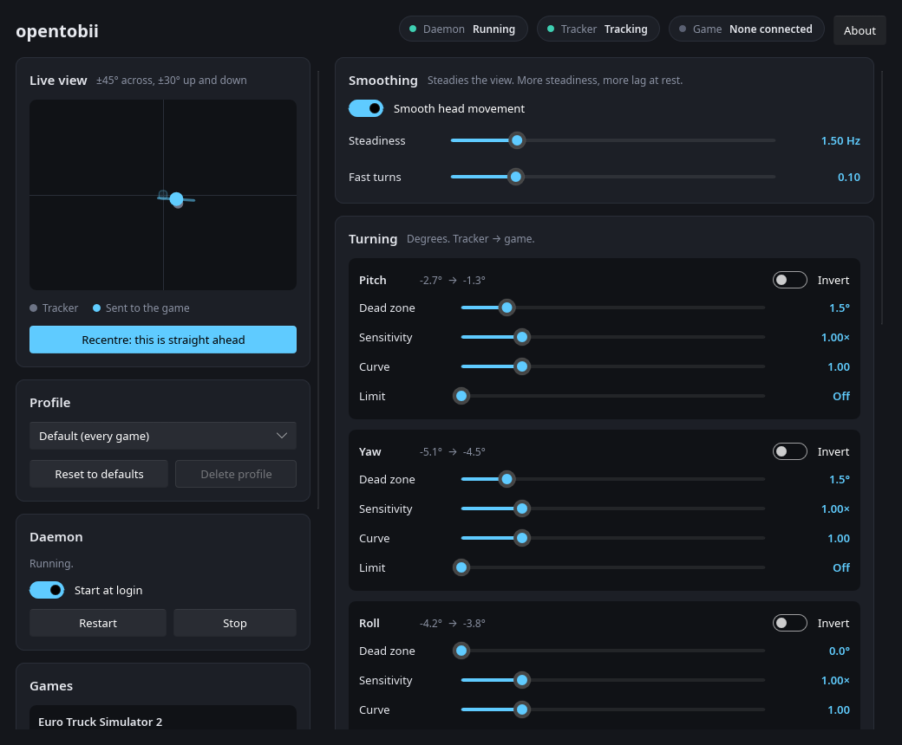

# opentobii

Head and eye tracking from a Tobii Eye Tracker 5 in Windows games running under Proton on Linux, and the tracker's infrared camera as a webcam for face login.

Not affiliated with Tobii.



## What it does

- **Games.** Games that ship Tobii's own `tobii_gameintegration` DLL see a tracker, as they do on Windows. No game files are changed. One small helper program and one registry key go into the game's Proton prefix, and both come out again cleanly.
- **Tuning.** A window to adjust smoothing, dead zone, sensitivity, curve and limits per axis, with a profile per game, and to recentre.
- **Gaze overlay.** An optional mark on screen showing where you are looking.
- **Face login.** The tracker's infrared picture published as a webcam, for [Howdy](https://github.com/boltgolt/howdy).

opentobii is not a USB driver. It builds on [Skyggedans/tobii-linux](https://github.com/Skyggedans/tobii-linux), which talks to the tracker.

## What it has been tested with

| | |
|---|---|
| Tracker | Tobii Eye Tracker 5 |
| Driver | Skyggedans tobii-linux 0.6.0 |
| Game | Euro Truck Simulator 2 (Tobii DLL 7.3.0.14): head tracking |
| Proton | Proton-CachyOS |
| System | Fedora 44, KDE Plasma 6.8 on Wayland |
| Face login | Howdy 3.0.0 with v4l2loopback 0.15.4 |

Other games that ship the same DLL should work the same way, and `opentobii games` lists the ones you have installed, in Steam or out of it. None but ETS2 has been tried. See [Known gaps](#known-gaps).

## Install

Install and calibrate the driver first: [Skyggedans/tobii-linux](https://github.com/Skyggedans/tobii-linux).

Then download `opentobii-<version>-x86_64-linux` from the [latest release](https://github.com/lerndmina/opentobii-bridge/releases/latest) and let it install itself. No root is needed:

```sh
chmod +x opentobii-*-x86_64-linux
./opentobii-*-x86_64-linux setup --autostart
```

That copies the program to `~/.local/bin`, adds **opentobii** to your app menu, and starts the background daemon now and at every login. `opentobii remove` takes it all out again and keeps your settings.

The release also carries an rpm, a deb and a tarball with an `install.sh`. A packaged copy lives under `/usr` and does not update itself.

## Set up a game

1. Close the game.
2. Open **opentobii** from the app menu. The Getting started list shows what is left to do, and the Games card lists the games that can use the tracker. Press **Set up** beside the game.
3. Start the game. If it has an eye tracking switch in its options, turn it on. Euro Truck Simulator 2 does.

The card lists Steam games that ship Tobii's DLL, and games outside Steam whose Wine prefix is in one of the usual places: `~/Games` (Lutris, Heroic, hand-made prefixes), Bottles and `~/.wine`. For a prefix anywhere else, press **Add a game folder…** and pick the folder that holds `drive_c`. Added folders are remembered in `~/.config/opentobii/games.txt`; **Forget** drops one from the list without touching it.

From a terminal, the same thing is:

```sh
opentobii games                  # every game found that ships Tobii's DLL
opentobii install 227300         # a Steam app id
opentobii install citizen        # part of a name
opentobii install ~/Games/star-citizen   # a prefix folder
opentobii uninstall 227300
```

Set up puts the helper under `drive_c/opentobii/` in the game's prefix and adds one service key to the prefix's `system.reg`, keeping a backup beside it. Removing it leaves `system.reg` byte for byte as it was. Both refuse to run while the game is open.

## Tuning

The window shows what the tracker sees against what is sent to the game, and edits the selected profile live.

- **Recentre** makes your current head pose "straight ahead".
- **Smoothing** steadies the view. More steadiness means more lag when you stop moving; "Fast turns" keeps quick movements responsive.
- **Turning and leaning** have, per axis, a dead zone, sensitivity, curve, limit and invert.
- **Profiles**: one default, and one per game if you make it. A game with no profile of its own uses the default.
- **Calibration** runs the driver's `tobii-calibrate` on the monitor you pick.
- **Daemon** starts, stops and restarts the background service, and sets whether it starts at login.

## Gaze overlay

The Gaze overlay card switches on a mark that shows where you are looking, with a short trail, drawn above everything including a full-screen game. Style (Bubble, Solid, Heatmap), colour, size, opacity, smoothing and trail are adjustable.

It needs a Wayland desktop with the layer-shell protocol: KDE Plasma, Sway, Hyprland or COSMIC. Screen capture only shows it when capturing the whole screen.

## Face login camera

The tracker films you in infrared to find your eyes. The daemon can publish that picture as a webcam, so Howdy can use the tracker the way it uses a laptop's infrared camera.

It needs the `v4l2loopback` kernel module with one device set aside. On Fedora, with RPM Fusion enabled:

```sh
sudo dnf install akmod-v4l2loopback v4l-utils
echo 'options v4l2loopback devices=1 video_nr=10 card_label="Tobii IR camera" exclusive_caps=1' | sudo tee /etc/modprobe.d/opentobii-camera.conf
echo v4l2loopback | sudo tee /etc/modules-load.d/opentobii-camera.conf
sudo akmods --force && sudo modprobe v4l2loopback
```

Then switch on **Face login camera** in the window. `opentobii status` says what the camera is doing.

The daemon asks the driver for pictures only while some program has the camera open and streaming, so nothing is published between logins. While it is switched on, any program allowed to open cameras can read it.

### Howdy

On Fedora 44 the `principis/howdy-beta` COPR does not install; `starfish/howdy-beta` does. Set two values in `/etc/howdy/config.ini`:

```ini
device_path = /dev/video10
dark_threshold = 90
```

The picture is a lit face in a dark room, so about half of it is near black. That is close to Howdy's default limit of 60% for skipping a frame as unlit, a rule meant for cameras whose infrared light flashes. The tracker's is steady.

Enrol with `sudo howdy add` and check with `sudo howdy test`. Once that recognises you, add Howdy where you want it. Each is one line, and your password keeps working as the fallback:

```sh
# sudo
sudo sed -i '1a auth       sufficient   pam_howdy.so' /etc/pam.d/sudo
# the KDE lock screen
sudo sed -i '1i auth        sufficient    pam_howdy.so' /etc/pam.d/kde
```

The login screen at boot is not covered. The tracker and the camera are only opened to whoever is logged in at the desk, the login manager runs confined by SELinux, and a face login would leave the KDE wallet locked, because the wallet is unlocked by the password typed at login.

Howdy's own advice applies: do not make face login the only way in.

## Updating

A copy installed with `setup` updates itself. The window looks for a newer release when it opens and every hour after, and shows a banner with an **Update** button; its About box has a **Check for updates** button. From a terminal:

```sh
opentobii update
```

Every release is signed, and an update is refused unless its signature matches the key built into the program (`packaging/update-key.pub`). The previous version is kept beside the new one and put back if the daemon does not start. To stop the window checking, put this in the settings file:

```toml
[updates]
check = false
```

## If something is not working

- **`opentobii status`** shows whether the driver is connected, whether a head is being tracked, which games are connected, and what the camera is doing.
- **The game ignores the tracker.** Check the game's own eye tracking option, and that the game was set up while closed. The game looks for a tracker every ten seconds, so it finds a daemon started after it.
- **Nothing for about twelve seconds after starting.** When its last client leaves, the driver restarts the tracker, and the next client waits for it.
- **A game's own profile is not used.** Per-game profiles need the current helper in the prefix. Close the game and press **Update** on the Games card.
- **Logs**: `journalctl --user -u opentobii`.

## Known gaps

- Only head tracking in Euro Truck Simulator 2 has been tried. Gaze-driven features in games have not.
- Valve's stock Proton has not been tried, only Proton-CachyOS.
- The game is told the tracker's identity from a recording, so it sees a placeholder serial number.
- A head pose with any part marked invalid by the driver is dropped whole.
- The gaze overlay needs layer-shell, which GNOME does not provide.

## Reference

### Commands

```
opentobii setup [--autostart]     install for your user
opentobii remove                  take that install out; settings are kept
opentobii update [--check]        update to the newest release
opentobii gui                     open the tuning window
opentobii status                  what the running daemon is connected to
opentobii service [start|stop|restart|enable|disable]
opentobii games                   Steam games that can use the tracker
opentobii install GAME [--helper PATH]
opentobii uninstall GAME
opentobii daemon [--no-smooth] [--monitor N] [--socket PATH] [--config PATH]
```

`opentobii help` explains each.

### Settings file

`~/.config/opentobii/config.toml`. The window writes it; it can be edited by hand while the daemon is stopped. A file with a mistake in it stops the daemon from starting and says what is wrong.

```toml
[default.yaw]
dead_zone = 1.5
sensitivity = 1.0
curve = 1.0
invert = false
limit = 0.0

[games."eurotrucks2.exe".yaw]
sensitivity = 2.0

[overlay]
enabled = false

[camera]
enabled = true
device = "/dev/video10"
```

A game is named by its executable's file name in lower case. Each axis (`pitch`, `yaw`, `roll`, `x`, `y`, `z`) has `dead_zone`, `sensitivity`, `curve`, `invert` and `limit`; `[default.smoothing]` holds the filter settings.

### Control socket

The daemon listens on `$XDG_RUNTIME_DIR/opentobii.sock`, one JSON object per line. The window uses it, and so can anything else.

| Request | Does |
|---|---|
| `{"cmd":"get"}` | Returns the settings and status |
| `{"cmd":"set_profile","game":"name.exe","profile":{...}}` | Replaces a profile; leave `game` out for the default |
| `{"cmd":"delete_profile","game":"name.exe"}` | Removes a game's profile |
| `{"cmd":"recentre"}` | Makes the current head pose neutral |
| `{"cmd":"set_overlay","overlay":{...}}` | Replaces the overlay's settings |
| `{"cmd":"set_camera","camera":{...}}` | Replaces the camera's settings |
| `{"cmd":"subscribe","poses":true,"gaze":false}` | Streams head poses, gaze points and a status line every second |

Changes apply at once and are saved to the settings file.

### How it works

Tobii's DLL in the game looks for a tracker service on `127.0.0.1:4455` and talks to it in Tobii's own protocol. The daemon answers there, with start-up replies recorded from a real tracker (`fixtures/et5`) and live gaze and presence from the driver rebuilt into the tracker's message layout.

Head pose and the display the tracker sits on travel a second way, over a Windows named pipe. Nothing on the Linux side can listen on a pipe inside Wine, so a small helper (`helper/sesp_relay.c`) runs as a service in the game's prefix and relays that pipe to the daemon on TCP port 47455.

Head pose passes through recentre, a One Euro filter, dead zone, sensitivity and limit before it reaches the game.

### Building

```sh
cargo build --release
cargo test
```

Needs Rust, `fontconfig-devel` for the window, and `mingw64-gcc` to build the helper into the binary. Without the cross compiler the binary builds with no helper inside, and `opentobii install` takes `--helper PATH`. `cargo build --no-default-features` builds the daemon and commands without the window or overlay.

The tests include an end-to-end run with a fake driver, game and helper. One more, ignored by default, runs the camera against the real driver and a real `v4l2loopback` device; `crates/opentobii/tests/camera_live.rs` says how.

## Licence

MIT, see `LICENSE`. The recorded messages in `fixtures/et5` are from Skyggedans/tobii-linux, also MIT, see `fixtures/et5/LICENSE-skyggedans`. The window is built with [Slint](https://slint.dev) under its royalty-free licence.
